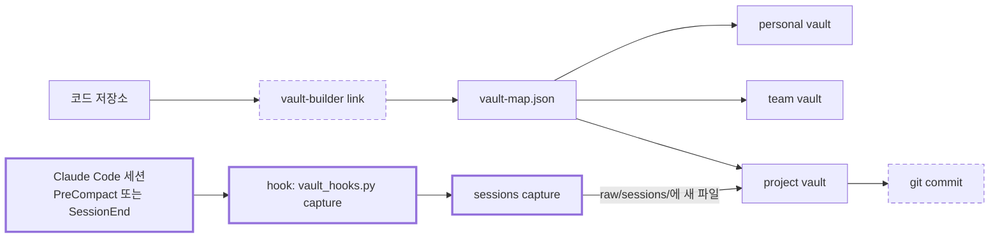

# vault-builder

vault-builder는 사람과 AI agent(Claude Code)가 함께 쓰는 vault를 만들어 줍니다.
vault는 markdown wiki 페이지를 담은 git 폴더입니다. 원본 자료는 `raw/`에 넣습니다.
agent가 그 자료로 페이지를 쓰고, 검사를 통과한 페이지만 `wiki/`에 들어갑니다.
vault-builder는 vault를 코드 저장소에 연결하고 Claude Code 세션도 보관합니다.



굵은 테두리는 자동으로 실행되는 단계이고, 점선 테두리는 사람이 하는 단계입니다.
설치할 때 `setup`도 저장소마다 `link`를 한 번 실행합니다. 세션 파일은 project
vault에만 들어가고, personal이나 team vault에는 들어가지 않습니다.

## 설치

Claude Code를 종료한 뒤 아래 명령을 실행합니다.

```bash
curl -fsSL https://raw.githubusercontent.com/cutehackers/vault-builder/main/scripts/install.sh | bash
```

질문마다 Enter를 누르면 다음이 생깁니다.

- 개인 vault: `$HOME/vault`
- project vault: `$HOME/vaults/<저장소 폴더 이름>`. git 저장소 안에서 명령을
  실행했을 때만 생깁니다.

명령이 끝나면 다음을 합니다.

1. Claude Code를 다시 시작합니다.
2. Claude Code에서 `/mcp`를 실행하고 `vault-wiki`가 연결되어 있는지 확인합니다.

옵션, 예전 vault 업그레이드, 제거 방법은 [docs/usage.md](docs/usage.md) 1절과
17.6절에 있습니다.

## 설치한 다음 할 일

- agent에게 wiki 작업을 부탁합니다. 예: "wiki-ingest skill로
  raw/sources/notes.md를 wiki에 반영해줘." skill은 `wiki-ingest`, `wiki-update`,
  `wiki-query` 세 가지입니다. [docs/usage.md](docs/usage.md) 2절과
  [docs/USER_PROMPTS.md](docs/USER_PROMPTS.md)를 봅니다.
- 다른 저장소를 연결합니다: `vault-builder link --repo /path/to/repo`.
  [docs/usage.md](docs/usage.md) 17.3절을 봅니다.
- 모두 정상인지 확인합니다: `vault-builder doctor`.
  [docs/usage.md](docs/usage.md) 17.6절을 봅니다.

## 자동으로 실행되는 일

설치가 끝나면 Claude Code가 세션 보관 한 가지를 알아서 실행합니다. 따로 할 일은
없고, 원하면 직접 실행할 수도 있습니다.

### 대화를 압축하기 전과 세션이 끝날 때: 세션 보관

Claude Code가 긴 대화를 압축하기 전과 세션이 끝날 때, 대화 내용을 이 저장소의
project vault `raw/sessions/`에 새 파일로 저장합니다. 새로 생긴 대화만 더하고,
이미 저장한 파일은 바꾸지 않습니다. thinking과 도구 출력은 빼고, 알려진 형식의
비밀값은 가립니다. commit은 하지 않으므로 사람이 commit합니다. 저장소에 project
vault가 없으면 저장하지 않습니다.

직접 하려면 agent에게 "이 세션 보관해줘"라고 말하거나, project vault 폴더에서 아래
명령을 실행합니다.

```bash
python3 tools/wiki/cli.py sessions capture --transcript "$HOME/.claude/projects/<key>/<session id>.jsonl"
```

자세한 내용: [docs/usage.md](docs/usage.md) 17.7절

설치는 세션 시작 hook도 더합니다. 이 hook은 혼자서는 세션에 아무것도 넣지
않습니다. 선택으로 설치한 회상 도구가 있을 때 그 도구가 돌려준 내용만 넣습니다.
자세한 내용: [docs/usage.md](docs/usage.md) 17절

## 직접 실행하는 명령

- 사실 첨부: 보관한 세션 파일 하나 옆에, 같은 이름에 `.facts.md`가 붙은 파일로
  날짜가 붙은 사실 목록을 더합니다. 쓰기 전에 사실 하나하나를 세션 파일과
  대조하고, 이미 있는 첨부는 덮어쓰지 않습니다. project vault 폴더에서 실행합니다.

  ```bash
  python3 tools/wiki/cli.py sessions attach-facts --session <세션 파일> --facts <facts.json>
  ```

  자세한 내용: [docs/usage.md](docs/usage.md) 17.7절

## 사람이 할 일

- agent가 추론한 기억은 사람이 승인하거나 거절할 때까지 `scratch/review/`에서
  기다립니다. `python3 tools/wiki/cli.py review list`로 보고,
  `review resolve <항목> --status accepted` 또는 `--status rejected`로 정합니다.
  [docs/usage.md](docs/usage.md) 13절을 봅니다.
- vault 변경은 사람이 commit합니다. 완료 여부는 `scripts/release_gate.sh`로
  확인합니다. [docs/usage.md](docs/usage.md) 18절과 20절을 봅니다.

## 더 자세한 문서

- [docs/usage.md](docs/usage.md): 전체 사용 안내. vault 역할 17.2절, MCP 서버
  16절, 폴더 5절, 기존 vault migration 1.1절, 전체 명령 19절
- [docs/LLM-WIKI.md](docs/LLM-WIKI.md): 구조와 원리
- [docs/agent/OPERATING-SCHEMA.md](docs/agent/OPERATING-SCHEMA.md): agent 규칙

---

English: [README.md](README.md)
