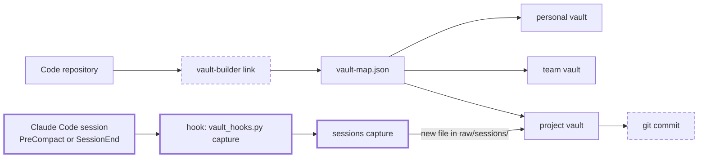

# vault-builder

vault-builder sets up vaults for you and your AI agent (Claude Code). A vault is
a git folder of markdown wiki pages. You put source material in `raw/`. The
agent turns it into pages, and a page enters `wiki/` only after a check passes.
vault-builder also links your vaults to your code repositories and saves your
Claude Code sessions.



Thick border: runs automatically. Dashed border: you do it. `setup` also runs
`link` once for each repository during install. Session files go only to the
project vault, never to personal or team vaults.

## Install

Quit Claude Code, then run:

```bash
curl -fsSL https://raw.githubusercontent.com/cutehackers/vault-builder/main/scripts/install.sh | bash
```

Press Enter at every question. You get:

- a personal vault at `$HOME/vault`,
- a project vault at `$HOME/vaults/<repository folder name>`, when you run the
  command inside a git repository.

When it finishes:

1. Start Claude Code again.
2. Run `/mcp` in Claude Code and check that `vault-wiki` is connected.

Options, upgrades of older vaults, and uninstall: [docs/usage.md](docs/usage.md)
§1 and §17.6.

## What to do next

- Ask the agent to work on the wiki. For example: "Use the wiki-ingest skill to
  add raw/sources/notes.md to the wiki." The skills are `wiki-ingest`,
  `wiki-update`, and `wiki-query`. See [docs/usage.md](docs/usage.md) §2 and
  [docs/USER_PROMPTS.md](docs/USER_PROMPTS.md).
- Link another repository: `vault-builder link --repo /path/to/repo`. See
  [docs/usage.md](docs/usage.md) §17.3.
- Check that everything works: `vault-builder doctor`. See
  [docs/usage.md](docs/usage.md) §17.6.

## What runs automatically

After install, Claude Code runs one step for you: session capture. You do not
need to do anything, and you can also run it by hand.

### Before compacting and when a session ends: session capture

Before Claude Code compacts a long conversation, and when a session ends, the
conversation is saved as a new file in `raw/sessions/` of this repository's
project vault. Only new turns are added, and saved files never change.
Thinking and tool output are left out, and known secret formats are hidden.
Nothing is committed. You commit the files. If the repository has no project
vault, nothing is saved.

By hand, ask the agent "Save this session to the vault", or run this in the
project vault folder:

```bash
python3 tools/wiki/cli.py sessions capture --transcript "$HOME/.claude/projects/<key>/<session id>.jsonl"
```

Details: [docs/usage.md](docs/usage.md) §17.7.

Install also adds a hook at session start. On its own it adds nothing to the
session. It only passes along what an optional recall tool returns, when one is
installed. Details: [docs/usage.md](docs/usage.md) §17.

## Commands you run yourself

- Fact attachment: adds a checked list of dated facts next to one saved
  session file, as a file of the same name ending in `.facts.md`. Every fact is
  checked against the session file first, and an existing attachment is never
  overwritten. Run it in the project vault folder:

  ```bash
  python3 tools/wiki/cli.py sessions attach-facts --session <session file> --facts <facts.json>
  ```

  Details: [docs/usage.md](docs/usage.md) §17.7.

## What needs you

- Memories that the agent inferred wait in `scratch/review/` until you accept
  or reject them: `python3 tools/wiki/cli.py review list`, then
  `review resolve <item> --status accepted` or `--status rejected`. See
  [docs/usage.md](docs/usage.md) §13.
- Commit vault changes yourself. Completion is checked with
  `scripts/release_gate.sh`. See [docs/usage.md](docs/usage.md) §18 and §20.

## More detail

- [docs/usage.md](docs/usage.md): full guide in Korean. Vault roles §17.2, MCP
  server §16, folders §5, migration of existing vaults §1.1, all commands §19.
- [docs/LLM-WIKI.md](docs/LLM-WIKI.md): architecture and vault structure.
- [docs/agent/OPERATING-SCHEMA.md](docs/agent/OPERATING-SCHEMA.md): rules for
  agents.

---

한글: [README-kr.md](README-kr.md)
